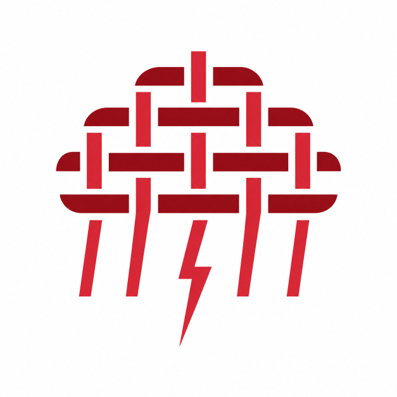

Welcome to the research group of **Youtong Zheng (郑又通)** in the [Department of Earth and Atmospheric Sciences](https://www.uh.edu/nsm/earth-atmospheric/) at the University of Houston.

We study clouds, convection, and extreme weather, and we ask one question of every model we use: **does it get the right answer for the right physical reason?** The name WEAVE reflects how we answer it. Field and satellite observations, theory, high-resolution simulations, machine learning, and now AI agents each see part of the picture; woven together, they can test whether a model's success is real.

## Right answers for the right reasons, in the AI-agent era

Climate models have long been tuned to match observations, which raises a hard question: *physics or knob-tuning?* (Our [2025 GRL paper](https://doi.org/10.1029/2025GL118740) asked exactly that about tropical anvil clouds.) Today models are increasingly built and tuned with AI, and AI agents can run whole analyses on their own. The question becomes **physics or shortcut?** An AI that raises a score may have found better physics, or only a shortcut to the score.

Youtong's career has been about combining tools: satellite retrievals, theory, large-eddy simulations, global and storm-resolving models, and machine learning. The lab now puts AI agents to work across all of them, and builds the tests that keep them honest: every AI result is checked against evidence the AI did not make, such as observations, a reference simulation, or a budget that must close.

## Research

- **Coastal storms.** Sea-breeze thunderstorms on the Texas Gulf Coast, and whether air pollution makes Houston's storms stronger. We test the U.S. Department of Energy's kilometer-scale storm-resolving model (E3SM/SCREAM) against observations from the TRACER field campaign.
- **Shallow clouds and climate.** How low clouds over the oceans and the Arctic form, break up, and respond to warming, sea-ice loss, and aerosols.
- **Physically trustworthy AI.** Machine learning that says when its predictions can be trusted, such as uncertainty-aware prediction of when storms start; physically interpretable AI; and AI agents that run and check model analyses.

Our work is funded by a [U.S. Department of Energy Early Career Award](https://www.uh.edu/nsm/news-events/stories/2023/1116-early-career-award.php). We collaborate with Lawrence Livermore, Pacific Northwest, and Argonne National Laboratories and with NOAA's Geophysical Fluid Dynamics Laboratory. See the [DOE ARM profile of the PI](https://www.arm.gov/news/features/post/72903).

## Join us

We are looking for **self-motivated PhD students and postdocs**. What you get in the WEAVE Lab:

- **Real questions and real tools.** Work with DOE's newest storm-resolving model, field data from Houston, and machine learning, on problems that matter to the Gulf Coast.
- **National-lab connections.** Our students have spent summers and fellowships at Lawrence Livermore National Laboratory.
- **AI-ready training.** A weekly AI Agent Day where the group learns to use AI agents in research, and to check what they produce.
- **Students who win.** Group members have earned a DOE graduate fellowship, AMS presentation awards, and university scholarships.

If you are interested, email Youtong at <yzheng18@uh.edu> with your CV and a short note on what you would like to work on.

## Recent news

- **Aug 2026:** Ashish Bhattarai received the NSM Graduate Student Conference Travel Award for Fall 2026.
- **Jul 2026:** Raymond Oware received the UH College of Natural Sciences and Mathematics Alumni Association (Eckhard Pfeifer/Carolyn Farb) Scholarship for 2026–2027.
- **Jul 2026:** Ashish Bhattarai's paper on uncertainty-aware machine learning for the onset of deep convection is published in *Geophysical Research Letters*. [[Article]](https://doi.org/10.1029/2026GL123315)
- **May 2026:** Raymond Oware received the department's Outstanding Graduate Work in Atmospheric Sciences Award. [[Link]](https://www.linkedin.com/feed/update/urn:li:activity:7459651947663441922/)
- **Feb 2026:** Raymond Oware won the Outstanding Student Presentation Award at the Fifth Symposium on Community Modeling and Innovation, AMS 2026 Annual Meeting. [[Link]](https://www.linkedin.com/feed/update/urn:li:activity:7431723796417531904/) [[EAS Newsletter]](https://newsletter.eas.uh.edu/issues/fall-2025-spring-2026/spotlight/poster-competition)
- **Jan 2026:** Ronin Costello was selected as a DOE Office of Science Graduate Student Research (SCGSR) Fellow and is spending two semesters at Lawrence Livermore National Laboratory studying Arctic clouds. [[NSM News]](https://www.uh.edu/nsm/news-events/stories/2026/0202-doe-award.php)
- **Jan 2026:** The group gave eight presentations at the AMS Annual Meeting, from coastal storms to marine shallow clouds. [[Link]](https://www.linkedin.com/posts/youtong-zheng-509a878a_ams2026-houston-convection-share-7420230728195575808-CVfG)

[All news &rarr;](/news/)
