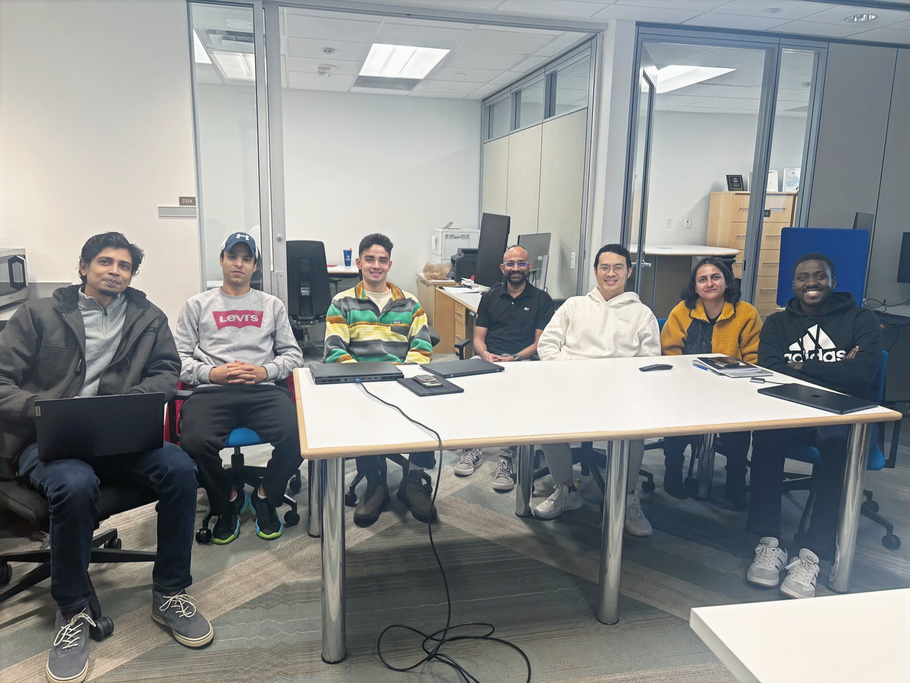
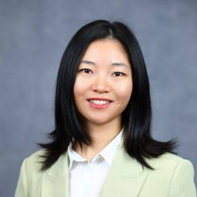
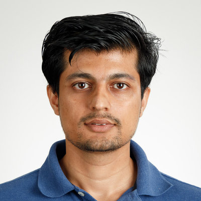
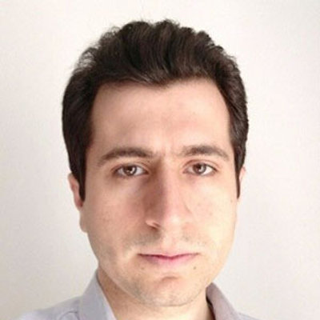

<figure>
  
  <figcaption>The group in the lab, January 23, 2025.</figcaption>
</figure>

## Current members

  
<b>Dr. Yichan Li</b>Postdoc PhD: University of ArkansasFlash droughts that turn into extreme rain in Texas

  
<b>Ronin S. Costello</b>PhD candidate BSc: Rutgers UniversityArctic clouds and sea-ice loss

  
<b>Malinda Millangoda</b>PhD candidate MSc: Nanjing University of Information Science and Technology, ChinaSea-breeze storms on the Texas Gulf Coast

  
<b>Raymond Kwaku Twumasi Oware</b>PhD candidate MSc: African Institute for Mathematical Sciences, GhanaStorms and aerosols in DOE's storm-resolving model

  
<b>Ashish Bhattarai</b>PhD candidate MSc: Tribhuvan University, NepalMachine learning for storms and storm organization

  
<b>Oussama Romdhani</b>PhD candidate MSc: University of HoustonTurbulent mixing and storm organization in km-scale models

  
<b>Nima Khorshidian</b>PhD candidate (co-supervised with Dr. Yunsoo Choi) MSc: Sharif University of Technology, IranAerosol effects on urban convective clouds

  
<b>May Sone</b>Undergraduate studentAI agents for weather research

## Alumni

- **Dr. Haipeng Zhang** (PhD 2025, University of Maryland; co-supervised with Dr. Zhanqing Li). Now at the University of Maryland, Baltimore County.
- **Dr. Meng Zhang** (Postdoc, 2025). Now in the energy industry.
- **Dr. Mampi Sarkar** (Postdoc, 2023–2025). Now at Rice University.

## Student awards

- **2026** · AMS Outstanding Student Presentation Award, Fifth Symposium on Community Modeling and Innovation (Raymond Oware) [[EAS Newsletter]](https://newsletter.eas.uh.edu/issues/fall-2025-spring-2026/spotlight/poster-competition) [[Post]](https://www.linkedin.com/feed/update/urn:li:activity:7431723796417531904/)
- **2026** · Outstanding Graduate Work in Atmospheric Science Award, Department of Earth and Atmospheric Sciences (Raymond Oware) [[Post]](https://www.linkedin.com/feed/update/urn:li:activity:7459651947663441922/)
- **2026** · NSM Alumni Association (Eckhard Pfeifer/Carolyn Farb) Scholarship, 2026–2027 (Raymond Oware) [[Scholarship]](https://uh.edu/nsm/students/scholarships/nsmaa-scholarships)
- **2026** · NSM Graduate Student Conference Travel Award (Ashish Bhattarai) [[Award]](https://ssl.uh.edu/nsm/students/graduate/financial-support/nsm-graduate-student-conference-travel-award-information-sheet.pdf)
- **2026** · Lawrence Livermore National Laboratory Atmospheric, Earth & Energy Graduate Student Summer Internship, second year (Raymond Oware) [[Program]](https://pls.llnl.gov/careers/internships)
- **2025** · DOE Office of Science Graduate Student Research (SCGSR) Award, Lawrence Livermore National Laboratory (Ronin Costello) [[UH News]](https://www.uh.edu/nsm/news-events/stories/2026/0202-doe-award.php)
- **2025** · Student Poster Presentation Award, 27th Annual Robert E. Sheriff Lecture (Malinda Millangoda) [[Event]](https://www.uh.edu/nsm/earth-atmospheric/news-events/sheriff-lecture/index.php)
- **2025** · UH Alumni Association (Eckhard Pfeifer/Carolyn Farb) Scholarship (Ashish Bhattarai) [[Scholarship]](https://uh.edu/nsm/students/scholarships/nsmaa-scholarships)
- **2025** · Outstanding Academic Achievement Scholarship in Atmospheric Science (Oussama Romdhani, Raymond Oware) [[Department awards]](https://www.uh.edu/nsm/earth-atmospheric/student-support/fellowships-scholarships/internal-awards/)
- **2025** · Lawrence Livermore National Laboratory Atmospheric, Earth & Energy Graduate Student Summer Internship (Raymond Oware) [[Program]](https://pls.llnl.gov/careers/internships)
- **2024** · UMD Dissertation Excellent Award; UMD Outstanding Publication in the Graduate Program; Eugene Rasmusson Fellowship (Haipeng Zhang)
- **2023** · Ann G. Wylie Dissertation Fellowship, University of Maryland (Haipeng Zhang)
