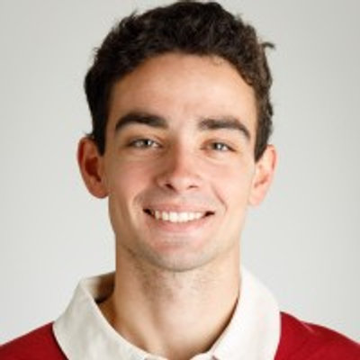
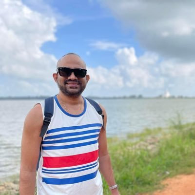
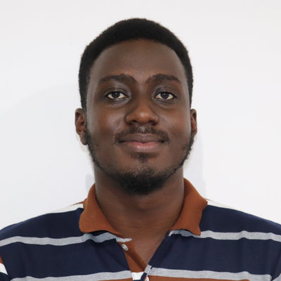
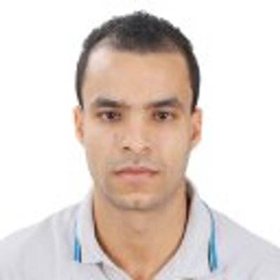

<figure>
  
  <figcaption>The group in the lab, January 23, 2025.</figcaption>
</figure>

## Current members

  
<b>Dr. Yichan Li</b>Postdoc PhD: University of Arkansas

  
<b>Ronin S. Costello</b>PhD candidate BSc: Rutgers University

  
<b>Malinda Millangoda</b>PhD candidate MSc: Nanjing University of Information Science and Technology, China

  
<b>Raymond Kwaku Twumasi Oware</b>PhD candidate MSc: African Institute for Mathematical Sciences, Ghana

  
<b>Ashish Bhattarai</b>PhD candidate MSc: Tribhuvan University, Nepal

  
<b>Oussama Romdhani</b>PhD candidate MSc: University of Houston

  
<b>Nima Khorshidian</b>PhD candidate (co-supervised with Dr. Yunsoo Choi) MSc: Sharif University of Technology, Iran

  
<b>May Sone</b>Undergraduate student

## Alumni

- **Dr. Haipeng Zhang** (PhD 2025, University of Maryland; co-supervised with Dr. Zhanqing Li). Now at the University of Maryland, Baltimore County.
- **Dr. Meng Zhang** (Postdoc, 2025). Now in the energy industry.
- **Dr. Mampi Sarkar** (Postdoc, 2023–2025). Now at Rice University.

## Join us

We welcome self-motivated PhD students and postdocs. Email Youtong at <yzheng18@uh.edu>.
