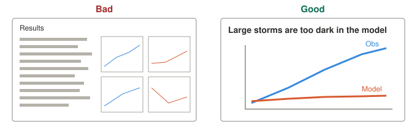
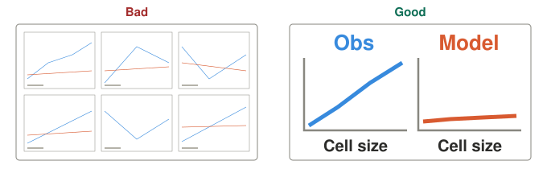
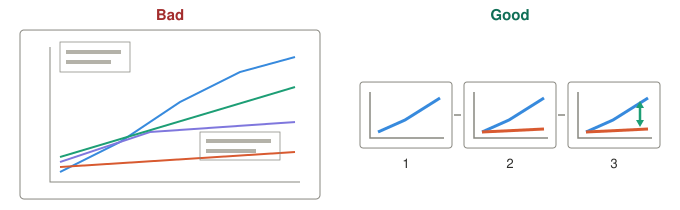
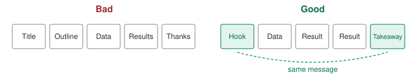

How we work in the WEAVE Lab. Group members: use this page as a checklist.

**Contents**
- [Presentations](#presentations)

<!-- To add a section: add a line to Contents above, then a new "## Title" block below, following the Presentations pattern. -->

## Presentations

For every talk: group meetings, committee meetings, and conferences such as AGU and AMS. The rules are listed in order of importance.

Most of the time, your audience doesn't want to listen to you. Unless they are paid to be there, as a committee is, the only reason they stay is that your talk is worth their time. A talk that breaks these rules wastes it.

**For your AI agent:** [presentation-rules.md](/files/presentation-rules.md){: download="presentation-rules.md"}. Download it and give it to your agent, so it can check your slides against these rules.

### 1. One slide, one message

Show everything, and you show nothing. A crowded slide means you don't know your point yet.

### 2. Big figures, big fonts

Stand in the audience's seat: design for the back row, not your laptop.

### 3. Build it up, tell a story

Storytelling is the core of a good talk. Reveal one piece at a time.

### 4. Hook first, end on the takeaway

If you can say it in one sentence, you know what you want to convey.

